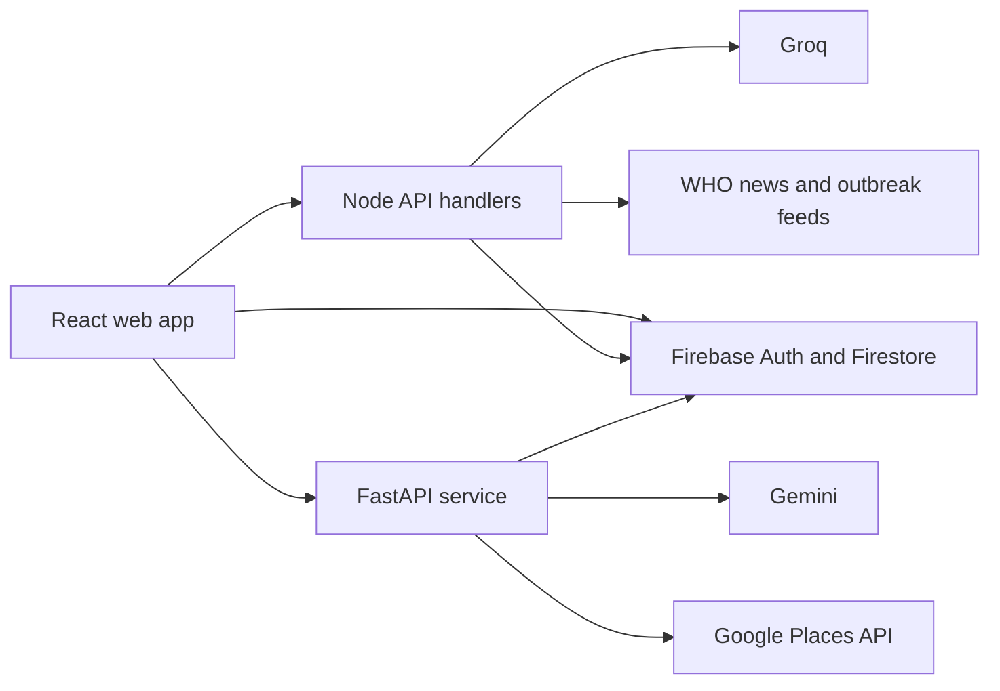

# DoctorXCare - AI-Powered Digital Health Platform


DoctorXCare brings symptom interviews, health information, lab report summaries, vital tracking, and nearby facility search into one web app. Firebase Authentication identifies users and Cloud Firestore stores saved records under their accounts.

> DoctorXCare provides educational health information and tools for organizing records. A qualified healthcare professional makes clinical decisions.

## Features

| Feature | Route | How it works |
| --- | --- | --- |
| Symptom Checker | `/symptom-checker` | Screens for urgent warning signs, asks 10–15 routine follow-up questions, and generates a care-guidance report with links to the disease library and nearby hospitals. Users can download the report or save it to History. Urgent concerns can end the interview early. |
| DoctorX AI Chat | `/doctorx-ai` | Sends recent chat turns to Groq for general health information. |
| Talk to Your AI Doctor | `/ai-doctor` | Runs a guided Groq consultation with spoken or typed answers, microphone controls, and browser read-aloud support. The flow accepts up to seven answers and can end early for urgent concerns. |
| Disease Library and WHO Updates | `/diseases` | Searches the bundled [disease catalog](public/data/diseases.json). A Node endpoint reads WHO news and disease outbreak reports from separate feeds. Users can save diseases to their account. |
| Lab Analysis | `/lab-analysis` | Validates a PDF, JPEG, or PNG up to 4 MiB and sends it to Gemini through FastAPI for a summary of the findings shown in the document. |
| Health Tracking | `/health-tracking/dashboard` and `/health-tracking/charts` | Saves manual readings or measurements extracted from uploaded reports. Charts display saved readings and the Python API supports analysis of readings and trends. |
| Nearby Hospitals | `/healthcare-network` | Uses browser location and Google Places API (New) to find facilities. The page offers a direct Google Maps search when the in-app finder or map is unavailable. |
| Account | `/dashboard`, `/my-profile`, and `/history` | Uses Firebase sign-in and shows the signed-in user's profile, saved assessments, and bookmarked diseases. |

## Architecture

The React and Vite frontend sends same-origin requests to `/api`. Firebase ID tokens accompany protected requests. The Node and Python APIs verify tokens before handling protected operations.



| Layer | Entry points |
| --- | --- |
| Browser | [Routes](src/App.jsx), [API client](src/services/apiClient.js), and [Firebase setup](src/firebase.js) |
| Node | [`api/`](api/) handles chat, voice consultations, symptom assessment, WHO feeds, and readiness. [`server/`](server/) handles token verification, Groq requests, and symptom interview state. |
| Python | [`doctorx_backend/main.py`](doctorx_backend/main.py) serves lab analysis, tracking, facility searches, and chronic care, recovery, and specialist API routes. [`api/medical.py`](api/medical.py) exports the same FastAPI app for Vercel. |
| Local routing | [`vite.config.js`](vite.config.js) and [`server/viteApi.js`](server/viteApi.js) serve Node handlers locally and proxy Python requests to Uvicorn. |

## Run locally

Use Node.js 22.12 or newer within the 22.x release and Python 3.12. Run these commands from the repository root.

```sh
npm ci
python -m venv .venv
```

Create `.env.local` in the repository root. Use the variable names below and fill in the providers you want to use. The empty values are placeholders.

```dotenv
GROQ_API_KEY=
LAB_SERVICE_API_KEY=
TRACKING_SERVICE_API_KEY=
GOOGLE_PLACES_API_KEY=
VITE_Maps_API_KEY=
```

| Variable | Purpose |
| --- | --- |
| `GROQ_API_KEY` | Server key for text chat, voice consultations, and symptom assessment. |
| `LAB_SERVICE_API_KEY`, `TRACKING_SERVICE_API_KEY` | Server keys for Gemini document and tracking requests. `GOOGLE_API_KEY` supplies a shared fallback. |
| `GOOGLE_PLACES_API_KEY` | Server key for facility search. The Google Cloud project needs billing and Places API (New) enabled. The server also accepts the legacy variable name `Maps_API_KEY`. [Google Places setup](https://developers.google.com/maps/documentation/places/web-service/get-api-key) |
| `VITE_Maps_API_KEY` | Optional browser key for the embedded map. Use a separate Maps JavaScript API key restricted to the app's origins. |
| `GROQ_CHAT_MODEL`, `GROQ_TRIAGE_MODEL` | Optional model overrides for text chat and symptom assessment. The assessment model must support strict structured outputs. |
| `GEMINI_MODEL`, `LAB_GEMINI_MODEL`, `TRACKING_GEMINI_MODEL` | Optional Gemini model overrides. Service-specific settings take precedence. |
| `TRIAGE_SESSION_SECRET` | Optional dedicated signing secret for symptom interviews. The code uses `GROQ_API_KEY` as a fallback. |
| `PYTHON_API_ORIGIN` | Optional Vite proxy target. Defaults to `http://127.0.0.1:8000`. |
| `DOCTORX_ALLOWED_ORIGINS` | Optional comma-separated list of extra origins allowed to call the Python API directly. |

Keep server keys in `.env.local` for development and in the hosting provider's environment settings for deployment. Variables prefixed with `VITE_` are available to browser code.

Start the Python API in one terminal.

```powershell
# Windows
.\.venv\Scripts\python.exe -m pip install -r requirements.txt
.\.venv\Scripts\python.exe -m uvicorn doctorx_backend.main:app --host 127.0.0.1 --port 8000
```

```sh
# macOS or Linux
./.venv/bin/python -m pip install -r requirements.txt
./.venv/bin/python -m uvicorn doctorx_backend.main:app --host 127.0.0.1 --port 8000
```

In a second terminal, run `npm run dev` and open the URL printed by Vite, usually `http://localhost:5173`.

## Firebase and data handling

- The app defaults to the bundled [public Firebase configuration](shared/firebase-public.json). For another project, configure the `VITE_FIREBASE_*` variables listed in [Firebase setup](src/firebase.js). Ensure both backends use the same Firebase web API key and the Python API uses the same Firebase project ID. `FIREBASE_WEB_API_KEY` and `FIREBASE_PROJECT_ID` can override the server configuration.
- Apply [`firestore.rules`](firestore.rules) to the target project before relying on account features. The rules restrict profiles, saved diseases, assessments, and readings to their owners. Feedback stores text and ratings separately from private contact details.
- The symptom interview token carries answers and expires after one hour. Its signature lets the server verify integrity and bind the session to a user. Groq receives chat turns and interview answers as text, including transcripts from the browser's voice input. Gemini receives lab uploads and readings submitted for AI analysis.
- Use synthetic data for development and demos. Voice input depends on browser support and microphone permission. Nearby facility results depend on the configured Google Places project and the user's location.

To use the Firebase Local Emulator Suite, start Auth and Firestore with `firebase emulators:start --only auth,firestore --project demo-doctorx`. Before starting the app, add these values to `.env.local`. [Firebase emulator guide](https://firebase.google.com/docs/emulator-suite/connect_firestore)

```dotenv
VITE_FIREBASE_PROJECT_ID=demo-doctorx
FIREBASE_PROJECT_ID=demo-doctorx
VITE_FIREBASE_AUTH_EMULATOR_HOST=127.0.0.1:9099
FIREBASE_AUTH_EMULATOR_HOST=127.0.0.1:9099
VITE_FIRESTORE_EMULATOR_HOST=127.0.0.1:8080
FIRESTORE_EMULATOR_HOST=127.0.0.1:8080
```

## Verify

Run the Python test command with the virtual environment activated or invoke its Python executable directly.

```sh
npm run lint
npm test
python -m unittest discover -s tests -p "test_*.py" -v
npm run build
```

Tests use synthetic reports and simulated provider responses. `GET /api/health` checks Groq configuration. `GET /api/python-health` checks Lab, Tracking, and Places key configuration. A `503` signals missing configuration. The endpoints check the presence of credentials, so verify provider access through the corresponding feature.

## Deploy

### Vercel

Use the repository root, the Vite preset, and `npm run build`. [`vercel.json`](vercel.json) routes Python requests to `api/medical.py` and serves the React entry point for page routes. Configure provider variables for the target deployment environment, including `GROQ_API_KEY` for the Node AI endpoints and the Gemini and Places credentials for FastAPI.

### Render

To deploy FastAPI as a standalone Python Web Service, open **Settings → Build & Deploy** and use these values.

| Setting | Value |
| --- | --- |
| Root Directory | Leave blank to build from the repository root. |
| Build Command | `pip install -r requirements.txt` |
| Start Command | `uvicorn doctorx_backend.main:app --host 0.0.0.0 --port $PORT` |
| Health Check Path | `/api/python-health` after setting the Python provider keys. |

For an existing service configured with `api/python-ai-agents`, clear that old Root Directory and deploy the latest commit. The root layout contains `requirements.txt`, `doctorx_backend/`, and `shared/`. Configure the Gemini and Places keys in Render's environment settings. [Render root directory guide](https://render.com/docs/monorepo-support) and [Render FastAPI guide](https://render.com/docs/deploy-fastapi)

## Project interview notes

- **Why Node and Python?** Node handles the conversational APIs and WHO feeds. FastAPI validates file uploads, handles Gemini requests, and serves facility and tracking APIs.
- **How do users keep their records private?** The API verifies the Firebase ID token for protected calls and Firestore rules grant access to records under the authenticated user's ID.
- **What happens if a provider fails?** The app shows an error, voice users can switch to typed answers when microphone access fails, and the nearby page can open Google Maps directly.
- **What does an assessment provide?** It summarizes reported information, suggests when to seek care, and helps a user prepare for a conversation with a clinician.
